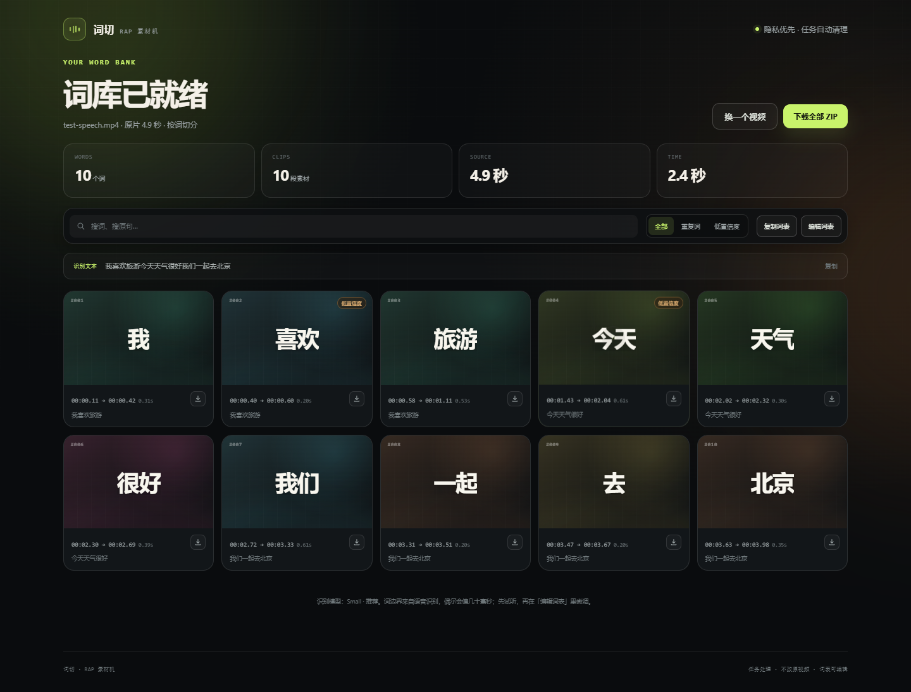

# 词切 · RAP 素材机

把一个演讲视频拆成「一个词一个片段」的素材库。适合做 RAP 鬼畜、词汇混剪、押韵采样和短视频二创。

[GitHub 仓库](https://github.com/zsh-mun/rap-word-splitter) · [用 Render 一键部署](https://render.com/deploy?repo=https://github.com/zsh-mun/rap-word-splitter)




## 它做什么

- 上传 MP4 / MOV / MKV / MP3 等常见音视频。
- 用 Whisper 做逐词语音识别，中文再用分词整理成「我 / 喜欢 / 旅游」这样的词。
- 用 ffmpeg 把每个词切成独立片段，文件名自动变成 `001_我.mp4`、`002_喜欢.mp4`。
- 可以导出 MP4、WAV 或两者；MP4 是 H.264 + AAC，能直接拖进剪映、Premiere、DaVinci。
- 自动打包 ZIP，里面带 `词表.csv`、`word_index.json`、完整识别文本。
- 结果页支持搜索、重复词筛选、低置信度筛选、试听、单词下载。
- 识别错字、时间偏了、分词不合适时，可以在「编辑词表」里改字、改时间、合并、删除，然后重新切片。

## 为什么不是 GitHub Pages

GitHub Pages 只能托管静态 HTML/CSS/JS，不能运行 Whisper、Python 或 ffmpeg。所以这是一个 **Python Web 服务**，推荐用 Docker 部署到 Render / Railway / 自己的服务器。GitHub 用来放代码，Render 之类的平台负责运行网站。

## 一键部署到 Render

仓库里已经包含 `render.yaml` 和 `Dockerfile`。

1. 仓库已经在 GitHub：[zsh-mun/rap-word-splitter](https://github.com/zsh-mun/rap-word-splitter)。
2. 打开 [Render 部署链接](https://render.com/deploy?repo=https://github.com/zsh-mun/rap-word-splitter)，登录后按 Blueprint 创建服务。
3. Render 会读取 `render.yaml`，创建一个 Docker Web Service。
4. 部署时建议设置 `SITE_PASSWORD`（站点访问口令）；不设置就是公开站点。
5. 部署完成后打开 Render 给出的网址。

免费实例内存较小，默认使用 `base` 模型。如果实例内存不够，把 `DEFAULT_MODEL` 改成 `tiny`；如果升级到更大内存，可以用 `small` 获得更好的中文识别。

`render.yaml` 里的默认限制：

| 变量 | 默认值 | 作用 |
| --- | --- | --- |
| `DEFAULT_MODEL` | `base` | 云端默认识别模型 |
| `MAX_UPLOAD_MB` | `200` | 单文件上传上限 |
| `JOB_TTL_HOURS` | `6` | 任务文件保留时间，到期自动删除 |
| `MAX_PENDING_JOBS` | `2` | 同时排队/处理的任务上限 |
| `SITE_PASSWORD` | 空 | 可选的访问口令 |

## 本地运行

Windows 可以双击 `start.bat`。第一次会自动创建 `.venv` 并安装依赖，之后打开本地网页。

手动运行：

```bash
python -m venv .venv
# Windows: .venv\Scripts\activate
# macOS/Linux: source .venv/bin/activate
pip install -r requirements.txt
python app.py
```

本地运行时需要 ffmpeg。仓库安装了 `imageio-ffmpeg` 作为兜底，也支持系统 `ffmpeg`；如果提示找不到 ffmpeg，请安装系统 ffmpeg 后重启。

## Docker

```bash
docker build -t rap-word-splitter .
docker run --rm -p 8000:8000 \
  -e DEFAULT_MODEL=base \
  -e MAX_UPLOAD_MB=500 \
  -e JOB_TTL_HOURS=24 \
  -e SITE_PASSWORD=your-password \
  rap-word-splitter
```

打开 `http://127.0.0.1:8000`。

Docker 镜像默认预下载 `base` 模型。想构建时多带一个 Small 模型：

```bash
docker build --build-arg PRELOAD_MODELS="base,small" -t rap-word-splitter .
```

如果构建环境访问模型镜像失败，也可以让容器在第一次使用时下载；程序会自动重试并回退。

## 环境变量

| 变量 | 默认值 | 说明 |
| --- | --- | --- |
| `DEFAULT_MODEL` | `small` | `tiny` / `base` / `small` / `medium` / `large-v3` |
| `MAX_UPLOAD_MB` | `3072` | 单文件大小上限，云端建议 200 左右 |
| `JOB_TTL_HOURS` | `24` | 完成任务保留小时数，`0` 表示不自动清理 |
| `MAX_PENDING_JOBS` | `3` | 同时排队/处理的任务上限 |
| `SITE_PASSWORD` | 空 | 设置后，进入页面和调用 API 需要口令 |
| `SECRET_KEY` | 随机生成 | Flask session 签名密钥；生产环境请固定 |
| `SESSION_COOKIE_SECURE` | `0` | HTTPS 部署时设为 `1` |
| `DATA_DIR` | `./data` | 任务文件目录 |
| `MODELS_DIR` | `./models` | Whisper 模型目录 |
| `HF_ENDPOINT` | `https://hf-mirror.com` | 模型下载镜像，可改成 Hugging Face 官方地址 |

## 实现方式

1. `ffmpeg` 提取 16kHz 单声道音轨。
2. `faster-whisper` 做带 word timestamps 的识别。
3. 中文按 Whisper 的词边界 + jieba 词典做合并/微调，避免把「今天天气」整段当成一个词，也避免把「旅游」拆成两个无意义的字。
4. 用 ffmpeg 精确切片；词与词紧挨着时会自动收窄留白，减少串音。
5. 输出 MP4 / WAV、CSV 时间轴、JSON 索引和 ZIP。

## 线上部署的边界

- 任务状态和文件都在单进程内存/本地磁盘里，所以 Docker 使用 **1 个 gunicorn worker**。要多实例扩展，需要把任务队列换成 Redis/Celery，把文件放到 S3/R2 等对象存储。
- Render 免费实例内存约 512MB，适合 `tiny` / `base` 和较短视频；`small` 建议至少 1GB 内存。
- 上传的视频只在任务目录里临时保存，默认 6 小时（Render 配置）后清理。
- 没有账号系统。「访问口令」只是一个轻量门槛；如果要公开给很多人使用，建议加登录、配额和对象存储。
- 语音识别不是 100% 准确，口音、背景音乐、多人说话都会影响结果。页面里的词表编辑器就是为修正这些问题准备的。

## 技术栈

Flask · faster-whisper · CTranslate2 · ffmpeg · jieba · vanilla JavaScript

## 下一步可以加

- 按拼音/韵母自动整理押韵词库
- 多视频合并成个人音色库
- 自动卡 BPM / 节拍
- 任务队列、账号、对象存储和用量配额
